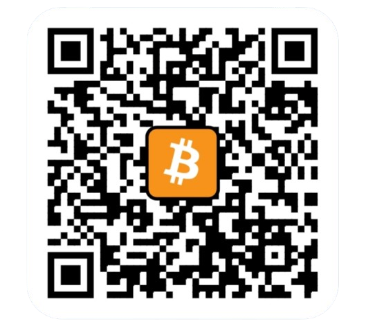
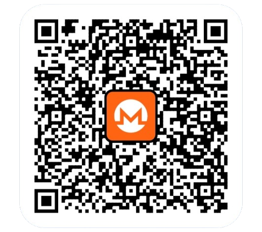

# LiveSubs

Free Android app: real-time translated subtitles for any live stream (Twitch, Kick, YouTube…), floating over any app.

- **Speech → text**: Vosk (offline, Apache 2.0). **Translation**: Google ML Kit (offline, free). Models are downloaded once, only for the languages you pick.
- **Translate into**: all 59 languages supported by ML Kit (phone language first). **Spoken language of the stream**: the 25 languages with a free Vosk voice model (names shown in the language you translate into). The app UI follows the phone language (English if unsupported).
- Customisable subtitles: text color/size, background color/opacity (live preview, applied instantly while running).

## Limits
Some apps block audio capture and DRM content is not captured. Small Vosk models are less accurate than Whisper. Android 10+

## Voice engine and translation (v1.4)
- **Whisper** (whisper.cpp, offline) is the default engine: far more accurate than Vosk, especially for Russian and Korean, and it understands 57 of the 59 languages. Models (60 MB or 190 MB) download once from Hugging Face. Speech is cut into sentences at pauses, so subtitles appear 3 to 8 seconds after the words. **Vosk** stays available as the instant option.
- **Translation**: by default the free Google Translate web endpoint (no key, needs internet; unofficial, so it may be limited or stop working; the transcribed text is sent to Google). Turn "Online translation" off to stay fully offline with ML Kit. ML Kit is also the automatic fallback.
- The workflow clones whisper.cpp (tag v1.7.4) at build time; the APK is 64-bit only.

## Voice model per language (v1.5)
Each spoken language has its own list of phone-friendly models, and the choice is remembered per language: Vosk small models (31 to 133 MB, instant), plus Whisper Tiny (30 MB), Base (60 MB) and Small (190 MB). Large Vosk models (300 MB to 2 GB) are not offered because they need several GB of RAM. Arabic and Swedish only have large Vosk models, so there they use Whisper.

## ❤️ Support the Project

If you enjoy using this app and find it useful, consider supporting its development with a cryptocurrency donation.

This project is free to use, and donations are entirely voluntary. Your support helps motivate continued development, improvements, and new features.

<table>
  <tr>
    <td></td>
    <td><strong>Bitcoin (BTC)</strong></td>
  </tr>
</table>

`bc1qm60gz8mq7he2xfsnkwvjwxs2fe0ll33w86720w`

<table>
  <tr>
    <td></td>
    <td><strong>Monero (XMR)</strong></td>
  </tr>
</table>

`4A1ChoXHVawF6JWjztGF2SSxQ4kRAsjJMBordqBdjV8rY7c7LkssuwTAod193H3Foj6SDao9nfKkwjNkhCHrxxHy6Ur84cp`

Thank you for your support! Every contribution is greatly appreciated ❤️
